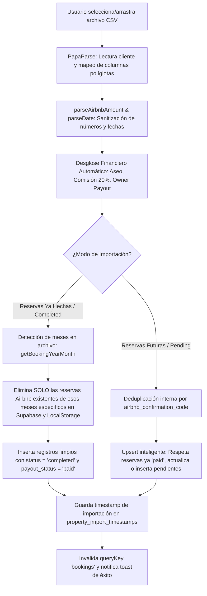

# 📖 Manual de Sistema e Instrucciones de la Aplicación

> **Documento Vivo de Arquitectura, Lógica de Negocio y Operaciones**  
> **Proyecto:** Apartment Manager (Gestión de Apartamentos Turísticos & Airbnb)  
> **Moneda Base:** Peso Colombiano (`COP` / `$`) con soporte para montos decimales  
> **Última Actualización:** 2026-11-01  
>
> ⚠️ **Regla de Mantenimiento:** Cualquier cambio funcional, refactorización o adición en el sistema debe actualizarse en este manual para mantener sincronizada la fuente de verdad.

---

## 📑 Tabla de Contenidos

1. [Visión General & Filosofía de Arquitectura](#1-visión-general--filosofía-de-arquitectura)
2. [Stack Tecnológico & Estructura del Código](#2-stack-tecnológico--estructura-del-código)
3. [Módulo: Importación Inteligente de Reservas (Airbnb CSV)](#3-módulo-importación-inteligente-de-reservas-airbnb-csv)
4. [Módulo: Gestión de Reservas (Bookings)](#4-módulo-gestión-de-reservas-bookings)
5. [Módulo: Control de Cerraduras Inteligentes (TTLock)](#5-módulo-control-de-cerraduras-inteligentes-ttlock)
6. [Módulo: Gastos (Expenses) & Escaneo con IA](#6-módulo-gastos-expenses--escaneo-con-ia)
7. [Módulo: Daños, Incidentes & Reclamaciones AirCover](#7-módulo-daños-incidentes--reclamaciones-aircover)
8. [Módulo: Guía de Huéspedes Digital & Tarjetas Wi-Fi](#8-módulo-guía-de-huéspedes-digital--tarjetas-wi-fi)
9. [Módulo: Analíticas Financieras & Métricas](#9-módulo-analíticas-financieras--métricas)
10. [Módulo: Asistente IA (Chatbot con Tool Calling)](#10-módulo-asistente-ia-chatbot-con-tool-calling)
11. [Protocolo de Actualización de este Manual](#11-protocolo-de-actualización-de-este-manual)

---

## 1. Visión General & Filosofía de Arquitectura

El **Apartment Manager** es una plataforma integral diseñada para la administración operativa, financiera y de accesos de propiedades de renta corta (Airbnb y reservas directas).

### Principios Fundamentales:
1. **Multi-Propiedad Aislada (`property_id`):** Todas las reservas, gastos, cerraduras y guías están estrictamente asociadas a un `property_id`.
2. **Cálculo Financiero Determinista:** Las finanzas (ingresos, comisiones, tarifas de aseo, IVA) se calculan con funciones matemáticas puras de precisión decimal, evitando aproximaciones no deterministas.
3. **Resiliencia Offline / Dual Sync:** Arquitectura híbrida que interactúa con Supabase (PostgreSQL) y mantiene sincronización en caché local (`localStorage`) para máxima velocidad y tolerancia a fallos de red.
4. **Agentes e IA Asistiva con Guardrails:** La IA se emplea como copiloto cognitivo (extracción multimodal de recibos, chatbot de consulta en lenguaje natural con herramientas deterministas), nunca para alterar datos críticos sin supervisión.

---

## 2. Stack Tecnológico & Estructura del Código

- **Frontend:** React 19 + TypeScript + Vite.
- **Estilos & UI:** Tailwind CSS 4 + shadcn/ui (Radix Primitives) + Lucide Icons.
- **Estado Servidor:** TanStack Query v5 (React Query) para caché, revalidación automática y mutaciones optimistas.
- **Backend & Base de Datos:** Supabase (PostgreSQL 15+) con Row Level Security (RLS) y Supabase Storage para fotos/recibos.
- **Orquestación IA:** Vercel AI SDK (`ai`, `@ai-sdk/react`), Zod para esquemas tipados y `unpdf` para ingestión de documentos.
- **Testing & E2E:** Vitest + React Testing Library + Playwright.

---

## 3. Módulo: Importación Inteligente de Reservas (Airbnb CSV)

> **Ubicación Principal:**  
> - UI Component: [`src/components/bookings/CsvImportModal.tsx`](file:///Users/axelwerner/Documents/Projects/Private/apartment-manager/src/components/bookings/CsvImportModal.tsx)  
> - Lógica de API & Persistencia: [`src/lib/api-service.ts`](file:///Users/axelwerner/Documents/Projects/Private/apartment-manager/src/lib/api-service.ts) (`upsertBookingsBatch`)  
> - Formateadores & Parsers: [`src/lib/formatters.ts`](file:///Users/axelwerner/Documents/Projects/Private/apartment-manager/src/lib/formatters.ts)  

### 3.1. Propósito y Problemática que Resuelve
Airbnb no ofrece una API abierta gratuita para anfitriones individuales; proporciona reportes en formato CSV de:
1. Reservas pasadas con cobros ya ejecutados (*Completed / Pagados*).
2. Reservas futuras y cobros proyectados (*Pending / Próximos cobros*).

El importador resuelve los siguientes desafíos del mundo real:
- **Soporte Políglota de Headers:** Las columnas varían según el idioma en que el anfitrión descargó el CSV (Alemán, Inglés, Español).
- **Formatos Numéricos Internacionales:** Variaciones entre formato europeo (`71.992,68`) y estadounidense (`71,992.68`).
- **Fechas Ambigüas:** Fechas en formatos `DD/MM/YYYY`, `MM/DD/YYYY` o `YYYY-MM-DD`.
- **Modificaciones de Reservas en CSV de Pendientes:** Cuando un huésped cambia fechas o huéspedes, Airbnb genera múltiples filas con el mismo código de confirmación.

---

### 3.2. Paso a Paso del Flujo de Importación

---

### 3.3. Detección de Columnas (Mapeo Políglota)

El parser inspecciona las columnas ignorando mayúsculas, minúsculas y acentos:
- **Código de confirmación:** `Bestätigungs-Code`, `Bestätigungscode`, `Confirmation code`, `Código de confirmación`, `Reservation code`, `Código`.
- **Nombre del huésped:** `Gast`, `Guest name`, `Nombre del huésped`, `Huésped`, `Guest`.
- **Fecha de reserva:** `Buchungsdatum`, `Booked date`, `Booking date`, `Fecha de reserva`, `Fecha de la reserva`, `Reservation date`.
- **Check-in / Check-out:** `Startdatum` / `Enddatum`, `Start date` / `End date`, `Fecha de inicio` / `Fecha de finalización`, `Check-in` / `Check-out`.
- **Noches:** `Nächte`, `Nights`, `Noches`, `# of nights`.
- **Cobro neto (Payout):** `Betrag`, `Ausgezahlt`, `Earnings`, `Amount`, `Total payout`, `Importe`, `Ganancias`, `Cobro neto`.
- **Ingreso bruto:** `Bruttoeinkünfte`, `Gross earnings`, `Ingreso bruto`.
- **Tarifa de limpieza:** `Reinigungsgebühr`, `Reinigungsgebuehr`, `Cleaning fee`, `Tarifa de limpieza`, `Limpieza`, `Aseo`.
- **Tarifa de servicio Airbnb:** `Servicegebühr`, `Service fee`, `Tarifa de servicio`, `Comisión`.
- **Filas de tipo pago (`Type`/`Typ`):** Si la columna indica `payout` o `auszahlung` (fila de resumen bancario de Airbnb), se ignora automáticamente.

---

### 3.4. Reglas Financieras y Desglose Automático

Para cada reserva válida importada:
1. **Noches válidas:** `validNights = nights > 0 ? nights : 1`.
2. **Tarifa de Limpieza (`cleaning_fee_collected`):**
   - Si la columna existe en el CSV, se respeta el valor exacto extraído (incluso si es `$0`).
   - Si no está presente en el archivo, se aplica el valor predeterminado del apartamento (`$60.000 COP`).
3. **Base de Alojamiento (`accommodationBase`):**
   $$\text{Base Alojamiento} = \max(0, \text{Net Payout} - \text{Cleaning Fee})$$
4. **Comisión de Administración (`managementFee`):**
   $$\text{Comisión} = \text{roundToTwoDecimals}(\text{Base Alojamiento} \times 0.20)$$
   *(Equivale al 20% convenido sobre los ingresos netos de hospedaje).*
5. **Pago al Propietario (`ownerPayout`):**
   $$\text{Pago Propietario} = \text{roundToTwoDecimals}(\max(0, \text{Base Alojamiento} - \text{Comisión}))$$
6. **Tarifa por Noche Promedio (`nightly_rate`):**
   $$\text{Tarifa Noche} = \text{roundToTwoDecimals}(\text{ownerPayout} / \text{validNights})$$

---

### 3.5. Modos de Operación: Completadas vs. Pendientes

#### Modo 1: Reservas Ya Hechas (`completed`) — Reemplazo Acotado por Mes
- **Objetivo:** Sincronizar el historial consolidado de reservas ya pagadas por Airbnb sin afectar otros periodos.
- **Importación Directa e Íntegra:** Se importan el 100% de los registros presentes en el archivo sin aplicar filtros destructivos de fechas pasadas ni omitir filas por marcas de tiempo previas.
- **Detección Automática de Meses:** El sistema analiza las fechas de `check_in` del archivo importado mediante `getBookingYearMonth` (ej. `'2026-04'`, `'2026-06'`).
- **Estrategia de Persistencia (Reemplazo Quirúrgico por Meses):**
  - **Solo borra y reemplaza las reservas de Airbnb de los meses presentes en el CSV importado.**
  - **Ejemplo práctico:** Si la base de datos contiene reservas de abril, mayo y junio, y se importa un archivo que solo contiene reservas de abril y junio:
    - Se eliminan y reemplazan las reservas de Airbnb de **abril y junio**.
    - Las reservas de **mayo quedan intactas** en la base de datos sin ninguna modificación.
    - Las reservas directas (`source === 'direct'`) de cualquier mes **nunca se tocan**.
- **Estados Asignados:** `status = 'completed'` y `payout_status = 'paid'`.

#### Modo 2: Reservas Futuras / Cobros Pendientes (`pending`)
- **Objetivo:** Registrar las reservas confirmadas a futuro antes de que Airbnb libere el dinero.
- **Auto-detección Segura:** Si todos los archivos cargados contienen `pending` en el nombre (ej. `airbnb_pending (9).csv`), el modal cambia automáticamente a modo `pending` para evitar reemplazos destructivos accidentales.
- **Deduplicación Previa:** Si el CSV contiene múltiples líneas para un mismo `airbnb_confirmation_code` (por extensiones o alteraciones), se conserva la fila con datos más completos y mayor monto bruto.
- **Estrategia de Persistencia (Upsert Selectivo No Destructivo):**
  - Nunca dispara borrado por meses (`deleteMonths`) ni elimina reservas ya completadas en meses superpuestos.
  - Si la reserva ya existe en la base de datos (Supabase o caché local) y su `payout_status == 'paid'`, **no se sobreescribe** (se protege la información de pago confirmada).
  - Si existe y está en `pending`, se actualizan sus fechas y montos.
  - Si es una reserva nueva, se inserta con `payout_status = 'pending'`.
  - Si ocurre un error de escritura en Supabase, la operación lo propaga explícitamente al usuario en lugar de ocultarlo.
- **Estados Asignados:** Calculado con `resolveBookingStatus`:
  - `confirmed` si la fecha de check-in es futura.
  - `checked_in` si el huésped ya está actualmente en el apartamento.

---

### 3.6. Auditoría y Trazabilidad de Importaciones
- **Autoría:** Cada reserva insertada recibe en su campo `notes` el detalle: `"Importado vía CSV Airbnb por [Nombre/Email del Usuario Activo]"`.
- **Timestamps por Propiedad:** La tabla `property_import_timestamps` en Supabase almacena:
  - `last_completed_import_at`: Fecha y hora UTC del último lote de completadas.
  - `last_pending_import_at`: Fecha y hora UTC del último lote de pendientes.
  - *Nota de UX:* Esta fecha se muestra de forma puramente informativa (con badge Supabase) para que el anfitrión sepa cuándo sincronizó por última vez, sin bloquear ni excluir reservas con fechas previas.

---

## 4. Módulo: Gestión de Reservas (Bookings)

- **Creación Manual:** Soporte para reservas directas (fuera de Airbnb) especificando huésped, teléfono, fechas, tarifa y notas.
- **Edición & Borrado:** Modificación en tiempo real con recálculo de noches y actualización del estado de cerraduras TTLock si corresponde.
- **Estados de Reserva:**
  - `confirmed`: Reserva futura confirmada.
  - `checked_in`: Huésped actualmente alojado.
  - `completed`: Estadía finalizada y checkout realizado.
  - `cancelled`: Reserva cancelada (no computa en métricas de ocupación).
- **Estados de Pago:**
  - `pending`: Pendiente de cobro / liquidación.
  - `paid`: Liquidado y pagado al anfitrión.

---

## 5. Módulo: Control de Cerraduras Inteligentes (TTLock)

> **Ubicación:** [`src/lib/ttlock-service.ts`](file:///Users/axelwerner/Documents/Projects/Private/apartment-manager/src/lib/ttlock-service.ts), [`src/components/bookings/TtlockPinModal.tsx`](file:///Users/axelwerner/Documents/Projects/Private/apartment-manager/src/components/bookings/TtlockPinModal.tsx)

- Permite generar códigos de acceso temporales (PIN) vinculados a las fechas y horas exactas del check-in (ej. 15:00) y check-out (ej. 11:00).
- Soporte para envío directo al huésped vía WhatsApp o visualización en la tarjeta digital.
- Validación de elegibilidad y estado de conexión de la pasarela (Gateway G2).

---

## 6. Módulo: Gastos (Expenses) & Escaneo con IA

> **Ubicación:** [`src/routes/Expenses.tsx`](file:///Users/axelwerner/Documents/Projects/Private/apartment-manager/src/routes/Expenses.tsx), [`api/scan-receipt.ts`](file:///Users/axelwerner/Documents/Projects/Private/apartment-manager/api/scan-receipt.ts)

- **Categorías:**
  - Administración de Edificio (Cuota fija mensual).
  - Servicios Públicos: Luz, Agua, Gas, Internet.
  - Operaciones: Aseo y lavandería (vinculable a una reserva mediante `linked_booking_id`).
  - Mantenimiento & Reposición de Insumos.
  - Póliza de Seguro Anual.
- **Ciclo de Vida de Servicios Recurrentes (Planilla Mensual):**
  - **1. 🟡 Esperando Factura (Inicio de Mes):** Al comenzar el mes, el anfitrión visualiza qué servicios tiene comprometidos (Administración, Agua, Internet/Teléfono, Gas, Luz) sin necesidad de que la factura haya sido emitida. El sistema calcula un **Estimado Inteligente** (promedio automático de los últimos 3 meses registrados o plantilla base) y destaca el calendario habitual de corte:
    - **Día 05:** Administración de Edificio
    - **Día 10:** Agua / Acueducto (EPM)
    - **Día 15:** Internet y TV / Teléfono (Tigo / Claro)
    - **Día 24:** Gas Natural (EPM)
    - **Día 25:** Energía / Luz (EPM)
  - **2. 🟠 Facturado / Por Pagar:** Al recibir la factura física o digital, se registra con monto real exacto y fecha límite de pago (ya sea manualmente o mediante escaneo directo con IA).
  - **3. 🟢 Pagado:** Se marca como cancelado y se adjunta el comprobante de transferencia bancaria.
- **Pipeline de Presupuesto Mensual:**
  - **Presupuesto Proyectado:** Facturado confirmado + Estimados de los servicios aún sin factura.
  - **Facturado Confirmado:** Compromisos con cuenta de cobro en mano.
  - **Total Pagado:** Dinero ya desembolsado.
  - **Restante por Cubrir:** Brecha total entre el presupuesto proyectado y lo pagado.
- **Integración con Dashboard:** Los servicios mensuales proyectados que están esperando factura se sincronizan automáticamente con la tarjeta operativa de **Facturas Pendientes** en [`src/routes/Dashboard.tsx`](file:///Users/axelwerner/Documents/Projects/Private/apartment-manager/src/routes/Dashboard.tsx) y se computan dentro de la métrica de gastos `⏳ Por pagar` del periodo. Esto evita que el anfitrión vea ganancias netas infladas al principio del mes y permite navegar directamente a la planilla con un clic.
- **Regla de Privacidad y Notificaciones de Servicios:** Los recordatorios y notificaciones de revisión y pago de servicios (tanto en la campana de la app como por correo electrónico) se envían **estrictamente a usuarios con rol `PRIMARY_OWNER` (Dueño Principal) y `OWNER` (Dueño/Copropietario)**. Los miembros con roles operativos (`ADMINISTRATOR`, `OPERATOR`, `CLEANER`, `VIEWER`) quedan excluidos de estas alertas financieras para proteger la privacidad patrimonial.
- **Centro de Notificaciones en la App (Campana 🔔):**
  - Implementado en [`src/components/invitations/InvitationsBell.tsx`](file:///Users/axelwerner/Documents/Projects/Private/apartment-manager/src/components/invitations/InvitationsBell.tsx) mediante el hook [`src/hooks/use-service-reminders.ts`](file:///Users/axelwerner/Documents/Projects/Private/apartment-manager/src/hooks/use-service-reminders.ts).
  - Pestaña de **Servicios** dedicada para dueños: detecta si hoy estamos a 2 días o en la fecha de corte y la factura del mes sigue en estado `awaiting_invoice` o `pending`. Muestra insignias de urgencia (*"Vence hoy"*, *"Venció día X"*, *"Vence en 2 días"*) y un botón de acceso directo que abre [`/expenses`](file:///Users/axelwerner/Documents/Projects/Private/apartment-manager/src/routes/Expenses.tsx) en el mes correspondiente.
- **Servicio Automatizado de Avisos por Email (Cron Job):**
  - Endpoint serverless [`api/cron-reminders.ts`](file:///Users/axelwerner/Documents/Projects/Private/apartment-manager/api/cron-reminders.ts) programado en [`vercel.json`](file:///Users/axelwerner/Documents/Projects/Private/apartment-manager/vercel.json) diariamente a las 13:00 UTC (08:00 AM hora Colombia).
  - Consulta las propiedades activas y evalúa si hoy es fecha de corte (días 5, 10, 15, 24 o 25) o aviso previo (2 días antes).
  - Filtra los destinatarios consultando `property_members` con `role IN ('PRIMARY_OWNER', 'OWNER')` y el `primary_owner_id`.
  - Envía correos con plantilla HTML responsive a través de la API de **Resend** (`RESEND_API_KEY`), o genera un reporte de diagnóstico seguro si opera en modo *dry-run*.
- **Escaneo Inteligente:** Ingestión de fotos/PDFs de facturas con modelo de visión multimodal. Extrae automáticamente monto, fecha, proveedor y categoría con validación de esquema en Zod. Integrado directamente en las tarjetas de servicios pendientes con el botón rápido de IA.

---

## 7. Módulo: Daños, Incidentes & Reclamaciones AirCover

> **Ubicación:** [`src/routes/Damages.tsx`](file:///Users/axelwerner/Documents/Projects/Private/apartment-manager/src/routes/Damages.tsx)

- Registro fotográfico de daños tras el check-out del huésped.
- Seguimiento de cotización estimada vs. costo real de reparación.
- Flujo de reclamación formal ante Airbnb AirCover o cobro de depósito.

---

## 8. Módulo: Guía de Huéspedes Digital & Tarjetas Wi-Fi

> **Ubicación:** [`src/routes/GuestGuideAdmin.tsx`](file:///Users/axelwerner/Documents/Projects/Private/apartment-manager/src/routes/GuestGuideAdmin.tsx), [`src/routes/WifiCardPage.tsx`](file:///Users/axelwerner/Documents/Projects/Private/apartment-manager/src/routes/WifiCardPage.tsx)

- Portal público responsive para el huésped sin necesidad de autenticarse.
- Tarjeta de Wi-Fi imprimible con código QR de conexión directa (protocolo `WIFI:T:...;S:...;P:...;;`).
- Instrucciones de llegada, reglas de la casa, electrodomésticos y recomendaciones locales.

---

## 9. Módulo: Analíticas Financieras & Métricas

> **Ubicación:** [`src/routes/Analytics.tsx`](file:///Users/axelwerner/Documents/Projects/Private/apartment-manager/src/routes/Analytics.tsx), [`src/lib/analytics-utils.ts`](file:///Users/axelwerner/Documents/Projects/Private/apartment-manager/src/lib/analytics-utils.ts)

- **KPIs Principales:**
  - **ADR (Average Daily Rate):** Tarifa promedio por noche vendida.
  - **RevPAR (Revenue Per Available Room):** Ingreso generado por noche disponible en el periodo.
  - **Tasa de Ocupación (%):** Días ocupados / días disponibles del mes o año.
  - **Flujo de Caja Neto (Net Cash Flow):** Ingresos netos cobrados menos la suma de gastos operativos y fijos.
- Visualización interactiva con Recharts: gráficos mensuales comparativos de ingresos vs. egresos y desglose por categoría.

---

## 10. Módulo: Asistente IA (Chatbot con Tool Calling)

> **Ubicación:** [`api/chat.ts`](file:///Users/axelwerner/Documents/Projects/Private/apartment-manager/api/chat.ts), [`src/components/ai/AiAssistantDrawer.tsx`](file:///Users/axelwerner/Documents/Projects/Private/apartment-manager/src/components/ai/AiAssistantDrawer.tsx)

- Interfaz tipo drawer accesible desde cualquier pantalla.
- **Arquitectura de Herramientas (Function Calling):** El LLM no calcula balances de cabeza; invoca herramientas deterministas como `getMonthlyFinancials(year, month)` o `getAnnualFinancials(year)` que consultan los datos reales.
- El modelo interpreta y responde en lenguaje natural claro y conciso con recomendaciones de optimización.

### 10.1 Monitoreo de Infraestructura de Modelos (Servidor Cephei) & Failover

> **Ubicación:** [`src/lib/ai/cephei-models.ts`](file:///Users/axelwerner/Documents/Projects/Private/apartment-manager/src/lib/ai/cephei-models.ts), [`scripts/monitor-cephei-models.ts`](file:///Users/axelwerner/Documents/Projects/Private/apartment-manager/scripts/monitor-cephei-models.ts), [`api/cephei-health.ts`](file:///Users/axelwerner/Documents/Projects/Private/apartment-manager/api/cephei-health.ts)

- **Catálogo y Disponibilidad:** La aplicación consume modelos LLM desde el servidor propio compatible con OpenAI (`https://cephei.ai/api/v1`). Para evitar interrupciones operativas por caídas o deshabilitación de modelos específicos, se implementa una arquitectura de inspección de salud y fallback dinámico.
- **Cadena de Contingencia (Fallback Hierarchy):**
  - **Chat & Agente Financiero:**
    - Modelo Principal: `galahad.qwen3.6-35b` (o `CUSTOM_LLM_MODEL`).
    - Cadena de Fallback: `galahad.qwen3.8-flash` ➔ `galahad.qwen3.5-122b` ➔ `qwen3.8:27b-mlx` ➔ `galahad.qwen3-coder` ➔ `nemotron-3.5-super:120b`.
  - **Visión & Escaneo de Facturas:**
    - Modelo Principal: `glm-5.3-flash:cloud` (o `CUSTOM_LLM_VISION_MODEL`).
    - Cadena de Fallback: `glm-5.3:cloud` ➔ `glm-5.2:cloud` ➔ `qwen3.8:27b-mlx` ➔ `nemotron-3.5-super:120b`.
- **Comando de Monitoreo CLI:**
  - Ejecución interactiva: `pnpm monitor:cephei`
  - Ejecución JSON estructurado: `pnpm monitor:cephei -- --json`
- **Endpoint de Salud Serverless:**
  - `GET /api/cephei-health`: Retorna estado general (`healthy`, `degraded`, `outage`), modelos activos, alertas y sugerencias de remediación.
- **Job Programado en Antigravity (`Cephei Models Monitor`):**
  - Ubicado en `~/.gemini/config/sidecars/cephei-models-monitor/sidecar.json`.
  - Ejecución horaria (`CRON_TZ=Europe/Berlin 0 * * * *`).
  - Lanza un agente autónomo que audita el servidor Cephei, detecta si un modelo configurado fue dado de baja y genera una alerta con las acciones requeridas de failover sin esperar a que un usuario experimente un fallo.

---

## 11. Protocolo de Actualización de este Manual

1. **Obligatoriedad:** Toda PR, refactor o feature nueva debe revisar si afecta alguno de los flujos explicados en este documento.
2. **Consistencia de Nombres:** Mantener siempre las rutas relativas en formato Markdown con enlaces clickables `[NombreArchivo](file:///ruta)`.
3. **Nivel de Detalle:** Describir tanto la experiencia de usuario (UI/UX) como las consideraciones técnicas de bajo nivel (edge cases, sanitización, concurrencia, esquemas de BD).
